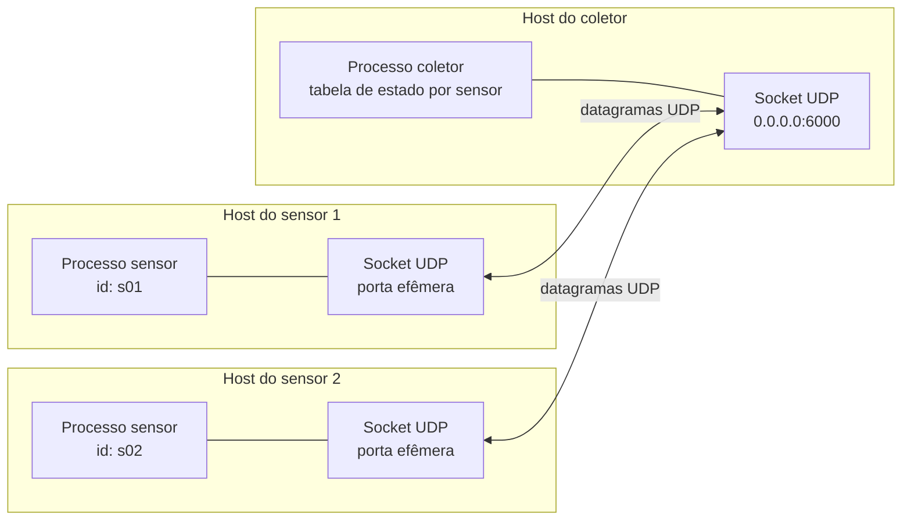
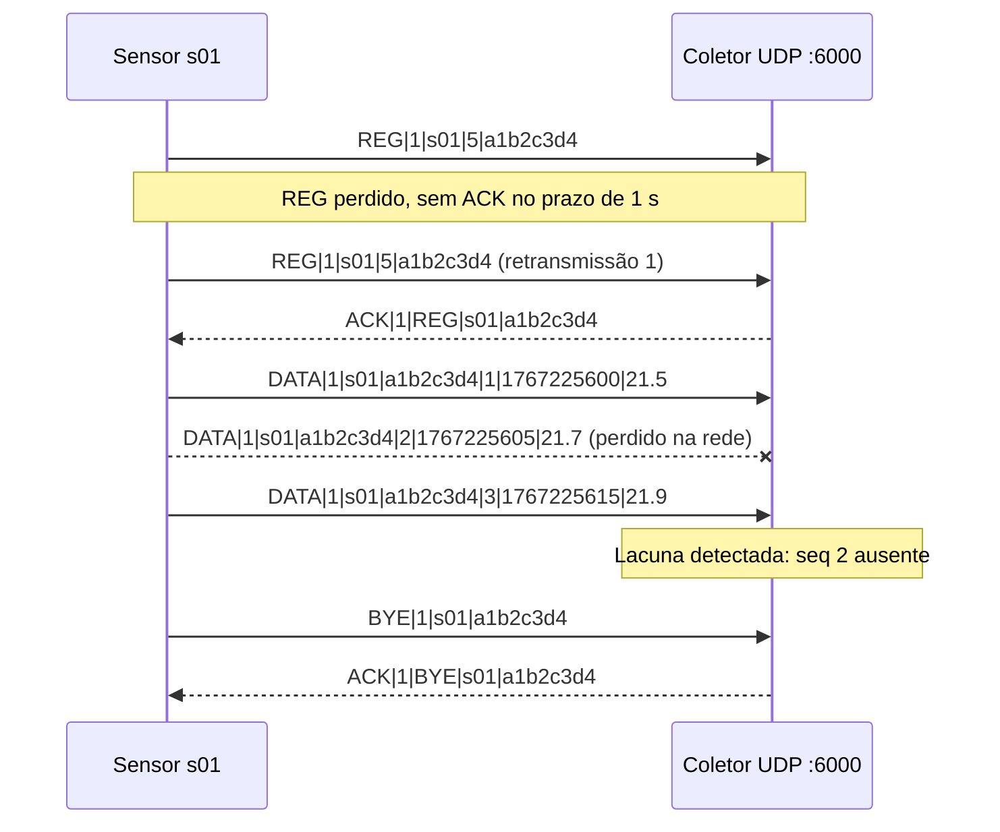
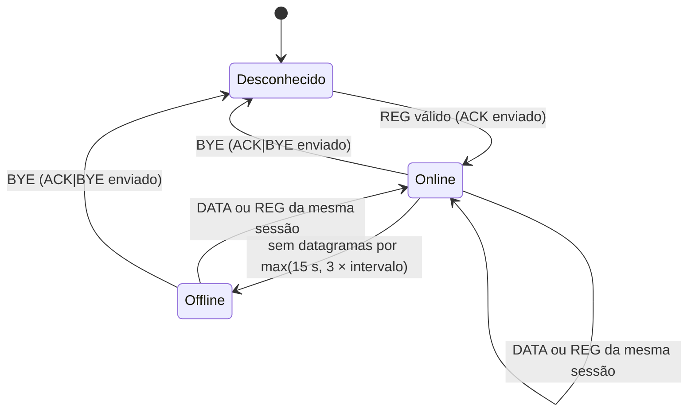

# Telem: Telemetria de Sensores com Sockets UDP

Trabalho avaliativo da disciplina **Fundamentos de Redes de Computadores**, baseado no Capítulo 2 (Camada de Aplicação) de *Redes de Computadores e a Internet: Uma Abordagem Top-Down*, de Kurose e Ross.

## 1. Descrição da aplicação

Sistema de coleta de telemetria. Sensores (por exemplo, temperatura e umidade) enviam leituras periodicamente a um coletor central, que registra os valores, detecta perdas e identifica sensores que deixaram de responder.

O problema resolvido é a coleta contínua de dados de muitos dispositivos pequenos, em que a leitura mais recente é mais útil que uma leitura antiga entregue com atraso. Isso torna a aplicação um bom caso para UDP.

Requisitos atendidos:

- Um coletor (servidor) e múltiplos sensores (clientes) simultâneos.
- Comunicação por sockets UDP (`SOCK_DGRAM`).
- Protocolo de aplicação próprio, em texto, chamado **TelemProto/1.0**.
- Mecanismos próprios de confiabilidade apenas onde são necessários (registro, saída e detecção de perdas).
- Extras do desafio implementados: múltiplos sensores simultâneos, logs do coletor (`--log-file` e `--json`), persistência do estado em JSON no encerramento e confiabilidade própria sobre UDP (retransmissão de `REG` e `BYE` e detecção de perdas).
- Tratamento de erros de rede, de protocolo e de entrada.

## 2. Integrantes

| Nome | Matrícula | Responsabilidade |
| --- | --- | --- |
| Renan Albuquerque Santos | 2025012480 | Servidor |
| Murilo Linhares | 2025012542 | Cliente |

## 3. Arquitetura

- **Coletor** (`src/collector.py`): único processo com um socket UDP ligado a uma porta fixa. Recebe datagramas de qualquer sensor, mantém uma tabela de estado por sensor (último número de sequência, último instante visto, situação) e responde apenas a `REG` e `BYE`, os comandos que exigem confirmação. Não mantém conexão com ninguém.
- **Sensor** (`src/sensor.py`): gera leituras simuladas, envia `REG` e depois um `DATA` a cada intervalo. Cada sensor tem um socket UDP próprio e uma **sessão** (8 caracteres hexadecimais gerados no boot). Retransmite `REG` e `BYE` até receber `ACK`.
- **Protocolo** (`src/protocol.py`): codificação, decodificação e validação das mensagens TelemProto/1.0.



Troca de mensagens com registro, leitura, perda e retransmissão:



Situação de cada sensor no coletor:



A linha de um sensor `Offline` continua na tabela para relatório, mas o identificador já está liberado: um `REG` de sessão nova é aceito. O `BYE` remove a linha após o período de retenção.

## 4. Protocolo de transporte: UDP

**Escolha: UDP** (`socket.SOCK_DGRAM`).

### Justificativa

1. **Dado tolerante à perda.** Uma leitura de temperatura substitui a próxima em poucos segundos. Retransmitir uma leitura antiga só ocupa a rede e atrasa a leitura atual. O livro (seção 2.1.3) afirma que aplicações tolerantes à perda não precisam de transferência confiável, e a Figura 2.4 classifica jogos interativos e telefonia como tolerantes à perda e sensíveis ao tempo, perfil semelhante ao de telemetria.
2. **Sem handshake.** Cada leitura cabe em um datagrama de poucas dezenas de bytes, enviado sem apresentação prévia. Não há atraso de conexão nem tráfego de controle por sensor.
3. **Sem estado de conexão no coletor.** Com centenas de sensores, o coletor não precisa de um socket e de buffers por dispositivo, como ocorreria com TCP (seção 2.1.4: UDP é um serviço não orientado à conexão e minimalista).
4. **Overhead menor.** O cabeçalho UDP tem 8 bytes, contra 20 bytes do TCP, além de não haver segmentos de confirmação para cada dado.
5. **Sem bloqueio de cabeça de fila.** Uma leitura atrasada não segura as seguintes, o que ocorreria em um fluxo TCP (ver o problema HOL discutido na seção 2.2.6).

Limitação assumida: o UDP não tem controle de congestionamento (seção 2.1.4). Por isso a aplicação limita a taxa, com intervalo mínimo de 1 s entre leituras e tamanho máximo de datagrama de 512 bytes.

### E se fosse usado TCP?

Funcionaria, mas com custos que não compensam para esse cenário:

- Cada sensor exigiria um handshake de três vias antes de enviar a primeira leitura, o que aumenta o atraso e o tráfego de controle.
- O coletor manteria uma conexão aberta e buffers por sensor. Com muitos sensores, isso consome memória e recursos do servidor, como discutido na seção 2.2.2 para conexões persistentes.
- Uma leitura perdida atrasaria todas as leituras seguintes até a retransmissão, o que entrega dados antigos com atraso e bloqueia os novos.
- A detecção de sensor offline dependeria de keepalive do TCP, em vez de um simples prazo sem datagramas.
- Em compensação, o TCP entregaria tudo sem perdas e na ordem correta, o que não é necessário aqui.

## 5. Endereço IP e porta

| Item | Valor padrão |
| --- | --- |
| Endereço IP do coletor | `127.0.0.1` em testes locais; IP da máquina do coletor na rede |
| Porta UDP do coletor | `6000` (configurável por argumento) |
| Porta dos sensores | Efêmera, atribuída pelo sistema operacional |

O coletor escuta em `0.0.0.0` por padrão. A porta 6000 está fora das portas bem conhecidas (0–1023), conforme a seção 2.1.2 do livro.

## 6. Protocolo da aplicação: TelemProto/1.0

- **Codificação:** ASCII imprimível (`0x20`–`0x7E`). `CR`, `LF` e `NUL` são inválidos.
- **Unidade de transmissão:** um datagrama UDP contém exatamente uma mensagem. Não é preciso delimitador de fim de mensagem, diferentemente do fluxo TCP. O UDP preserva fronteiras de mensagem.
- **Campos:** separados por `|`, sem campo vazio e sem espaço nas pontas.
- **Versão:** primeiro campo depois do tipo, hoje sempre `1`. Mensagem com outra versão recebe `ERR|BAD_REQUEST`.
- **Tamanho máximo:** 512 bytes por datagrama. O coletor lê com buffer de 65 535 bytes e compara o tamanho com 512 (um `recvfrom` de 512 bytes truncaria em silêncio); acima disso responde `ERR|TOO_LONG` e descarta.
- **Identificador do sensor:** de 1 a 16 caracteres alfanuméricos, sensível a maiúsculas, único na rede.
- **Sessão:** 8 dígitos hexadecimais minúsculos gerados no boot do processo sensor. Diferencia uma **retransmissão** de `REG` (mesma sessão) de um **reinício** do sensor (sessão nova).
- **Número de sequência:** inteiro crescente por sensor, iniciando em 1 **a cada sessão** (não a cada `REG`). Usado para detectar perdas, duplicatas e reordenação.
- **Timestamp:** segundos desde a época Unix, no relógio do sensor. Serve para exibição; a ordem é dada pelo número de sequência.

## 7. Mensagens

**Sensor → Coletor**

| Mensagem | Formato | Confirmação | Descrição |
| --- | --- | --- | --- |
| REG | `REG\|versao\|id\|intervalo\|sessao` | Sim (ACK) | Registra a sessão do sensor e informa o intervalo entre leituras, em segundos (1 a 3600). 1 envio + 3 retransmissões de 1 s. Idempotente: reenviar com a mesma sessão não zera contadores. |
| DATA | `DATA\|versao\|id\|sessao\|seq\|timestamp\|valor` | Não | Envia uma leitura. Não é retransmitida. O primeiro `DATA` da sessão define a linha de base da sequência. |
| BYE | `BYE\|versao\|id\|sessao` | Sim (ACK) | Anuncia a saída e libera o identificador na hora. Reenviado até 2 vezes, com prazo de 500 ms. Se se perder, o coletor libera o identificador pelo timeout de silêncio. |

**Coletor → Sensor**

| Mensagem | Formato | Descrição |
| --- | --- | --- |
| ACK | `ACK\|versao\|REG\|id\|sessao` e `ACK\|versao\|BYE\|id\|sessao` | Confirma `REG` ou `BYE`. O tipo confirmado e a sessão permitem ao sensor descartar um ACK atrasado de uma sessão anterior. |
| ERR | `ERR\|versao\|codigo\|descricao` | Informa erro de formato ou de estado (ver seção 8). É apenas informativo: não é confirmado e não dispara retransmissão. |

Os valores de `DATA` são sempre numéricos, com até 3 casas decimais, ponto como separador (nada de vírgula ou expoente) e faixa aceita de -50 a 150. Valores fora da faixa geram `ERR|VALUE_OUT_OF_RANGE`.

## 8. Tratamento de erros

| Situação | Quem trata | Tratamento |
| --- | --- | --- |
| `REG` ou `ACK` perdido | Sensor | 1 envio + 3 retransmissões de `REG`, com 1 s de espera. Sem `ACK`, descarta a leitura e tenta de novo no próximo intervalo; nenhum `DATA` é enviado antes do `ACK`. |
| `BYE` ou `ACK` do `BYE` perdido | Sensor | Reenvia `BYE` até 2 vezes (500 ms) e encerra de qualquer forma; o coletor libera o identificador pelo timeout. |
| `DATA` perdido | Coletor | Detecta lacuna na sequência e soma ao contador de perdas **um por datagrama faltante**. Não há retransmissão, pois o dado já estaria obsoleto. |
| `DATA` duplicado | Coletor | Descarta quando `seq` já foi visto na janela recente (64) e incrementa o contador de duplicatas. |
| `DATA` fora de ordem | Coletor | Descarta quando `seq` é menor que o último aceito e não está na janela recente, registrando reordenação. |
| Sensor silencioso | Coletor | Após `max(15 s, 3 × intervalo)` sem datagramas, marca o sensor como `Offline`. Volta a `Online` com o próximo datagrama da mesma sessão. A linha continua na tabela para relatório, mas o identificador já está liberado. |
| Porta do coletor fechada (ICMP port unreachable) | Sensor | No Linux, o próximo `recvfrom` levanta `ConnectionRefusedError`. Tratado como "coletor indisponível": loga e tenta no próximo ciclo. |
| Mensagem malformada (campos ausentes, versão desconhecida, sessão inválida, tipos inválidos) | Coletor | `ERR\|BAD_REQUEST`. Não altera o estado do sensor. |
| Datagrama acima do limite de 512 bytes | Coletor | Lido com buffer de 65 535 bytes; se o tamanho passar de 512, responde `ERR\|TOO_LONG` (resposta de até 64 bytes) e descarta. |
| `REG` com sessão nova para identificador já ativo | Coletor | `ERR\|NAME_IN_USE`; o estado existente não é alterado. |
| `interval` fora de 1 a 3600 | Coletor | `ERR\|BAD_INTERVAL`. |
| Reinício do sensor sem `BYE` | Coletor | O `REG` de sessão nova só é aceito depois do timeout de silêncio; até lá recebe `ERR\|NAME_IN_USE` e o sensor retenta a cada intervalo. |
| Valor fora da faixa | Coletor | `ERR\|VALUE_OUT_OF_RANGE`. O datagrama é descartado. |
| `DATA` de sensor não registrado | Coletor | `ERR\|NOT_REGISTERED`, para o sensor enviar `REG` novamente. |
| Erro ao enviar (`OSError`, rede inacessível) | Sensor | Captura, registra e tenta no próximo ciclo. |
| Ctrl+C no sensor | Sensor | Envia `BYE` e aguarda `ACK\|BYE` por até 1,5 s (3 tentativas de 500 ms); encerra de qualquer forma. |
| Exceção ao processar um datagrama | Coletor | `try/except` por datagrama; o laço principal continua. |

Observação de segurança: respostas `ERR` são enviadas ao endereço de origem do datagrama. Como o UDP aceita endereços forjados, o coletor limita cada `ERR` a 64 bytes, envia no máximo 1 por IP de origem por segundo (20 por segundo no total), não ecoa dados da requisição e nunca altera o estado por causa de uma mensagem inválida. A sessão dá idempotência, não autenticidade: o protocolo não tem autenticação.

## 9. Estrutura do repositório

```
trabalho-redes/
├── README.md
├── docs/
│   ├── PROTOCOLO.md
│   └── REQUISITOS-SERVIDOR.md
├── capture/
│   ├── NOTAS-DEMO.md       # verificações e roteiro da apresentação
│   └── telemetria.pcapng
└── src/
    ├── __init__.py
    ├── protocol.py
    ├── collector.py
    └── sensor.py

```

O arquivo `collector-state.json` é gerado em tempo de execução pelo coletor e não faz parte do repositório.

## 10. Instruções de execução

**Requisitos:** Python 3.10 ou superior. Não há dependências externas (apenas biblioteca padrão: `socket`, `selectors`, `secrets`, `time`, `random`, `argparse`, `json`, `logging`, `os`).

Os comandos abaixo são executados **na raiz do repositório**, porque `src` é um pacote. No Windows, use `python` no lugar de `python3`.

### 1. Iniciar o coletor:

Em um terminal:

```sh
python3 -m src.collector --host 0.0.0.0 --port 6000
```

### 2. Iniciar um ou mais sensores

Em outros terminais:

```sh
python3 -m src.sensor --host 127.0.0.1 --port 6000 --id s01 --interval 5
python3 -m src.sensor --host 127.0.0.1 --port 6000 --id s02 --interval 3
```

>[!tip]
>Para testar em rede local, substitua `127.0.0.1` pelo IP da máquina do coletor.

### Teste de perda de `DATA`:

O sensor aceita `--loss 0.2`, que descarta aleatoriamente 20% dos `DATA` antes do envio. Use para verificar a detecção de lacunas no coletor.

### Teste de perda de `ACK`:

O coletor aceita `--drop-ack 0.3`, que descarta 30% dos `ACK`/`ERR` enviados. Use para observar a retransmissão do `REG` no Wireshark.

### Persistência do estado:

Por padrão, o coletor carrega `collector-state.json` ao iniciar e grava o estado nele ao encerrar com `Ctrl+C`/`SIGTERM`. O arquivo guarda a tabela, os contadores, a janela de sequências e as últimas leituras de cada sensor, então um reinício continua de onde parou.

```sh
python3 -m src.collector --state-file meu-estado.json
python3 -m src.collector --no-state
```

- `--state-file ARQUIVO` escolhe outro caminho; `--no-state` desliga a persistência.
- A gravação é atômica: o JSON é escrito em `ARQUIVO.tmp` e só então substitui o arquivo final.
- Um arquivo ausente inicia a tabela vazia; um arquivo inválido gera erro no log e também inicia vazio, sem derrubar o coletor.
- Os timeouts continuam usando `time.monotonic()`; no carregamento, a idade de cada sensor é reconstruída a partir dos instantes de parede salvos.

### Saída do coletor:

Tabela com identificador, situação, endereço, intervalo, último número de sequência, último valor, idade do último datagrama e contadores de perdas, duplicatas e reordenações. Em um terminal, a tabela é redesenhada no mesmo lugar a cada `--refresh` segundos; com a saída redirecionada para um arquivo, cada atualização é acrescentada como um bloco novo.

## 11. Captura de tráfego (Wireshark)

Arquivo: `capture/telemetria.pcapng`. Filtro de exibição: `udp.port == 6000`.

A captura foi feita no loopback do WSL2 com `tcpdump` e reúne quatro cenários (sessão normal, ACK perdido, perda de DATA e reinício sem BYE). Os quadros têm comentários de pacote marcando cada ponto; a correspondência quadro a quadro, os resultados de V-01..V-09/AC-01..AC-16 e o roteiro da apresentação estão em [capture/NOTAS-DEMO.md](./capture/NOTAS-DEMO.md).

Evidências a apresentar:

1. **Ausência de handshake:** o primeiro datagrama já é `REG`, sem SYN, SYN-ACK ou ACK.
2. **Payload legível:** `REG|1|s01|5|a1b2c3d4`, `DATA|1|s01|a1b2c3d4|3|...` e `ACK|1|REG|s01|a1b2c3d4` aparecem em texto claro (use *Follow UDP Stream*).
3. **Cabeçalho UDP de 8 bytes:** comparar com o cabeçalho TCP, de no mínimo 20 bytes, que seria usado se a aplicação adotasse TCP.
4. **Retransmissão do REG:** com `--drop-ack 0.5` no coletor, dois `REG` com a **mesma sessão** e cerca de 1 s de diferença.
5. **Lacunas de sequência:** datagramas `DATA` com números de sequência faltando, correspondendo aos registros do coletor.
6. **Ausência de controle de congestionamento:** os datagramas saem no ritmo definido pela aplicação, sem reduções de taxa.
7. **Sessão:** reiniciar o sensor muda os últimos 8 caracteres; a retransmissão do `REG` os mantém iguais. É o que separa perda de `ACK` de reinício do processo.

## 12. Mapeamento das questões do projeto

| Questão do projeto | Onde responder |
| --- | --- |
| 1. Qual problema a aplicação resolve? | Seção 1 |
| 2. Quem são os processos envolvidos? | Seção 3 |
| 3. Como ocorre a comunicação? | Seções 3 e 6; [PROTOCOLO.md](./docs/PROTOCOLO.md) §2 |
| 4. Qual protocolo de transporte? | Seção 4 |
| 5. Por que esse protocolo é adequado? | Seção 4, "Justificativa" |
| 6. Qual é o protocolo da aplicação? | Seções 6 e 7; [PROTOCOLO.md](./docs/PROTOCOLO.md) |
| 7. Quais mensagens podem ser trocadas? | Seção 7; [PROTOCOLO.md](./docs/PROTOCOLO.md) §5 |
| 8. O que aconteceria com o outro protocolo? | Seção 4, "E se fosse usado TCP?" |
| 9. Quais situações de erro podem ocorrer? | Seção 8; [REQUISITOS-SERVIDOR.md](./docs/REQUISITOS-SERVIDOR.md) §7 |
| 10. Como essas situações são tratadas? | Seção 8; [PROTOCOLO.md](./docs/PROTOCOLO.md) §7.3 e [REQUISITOS-SERVIDOR.md](./docs/REQUISITOS-SERVIDOR.md) §6–§7 |

Especificação detalhada: [PROTOCOLO.md](./docs/PROTOCOLO.md) (gramática, mensagens, erros e a máquina de estados do sensor) e [REQUISITOS-SERVIDOR.md](./docs/REQUISITOS-SERVIDOR.md) (requisitos, contadores, interface e critérios de aceitação).
