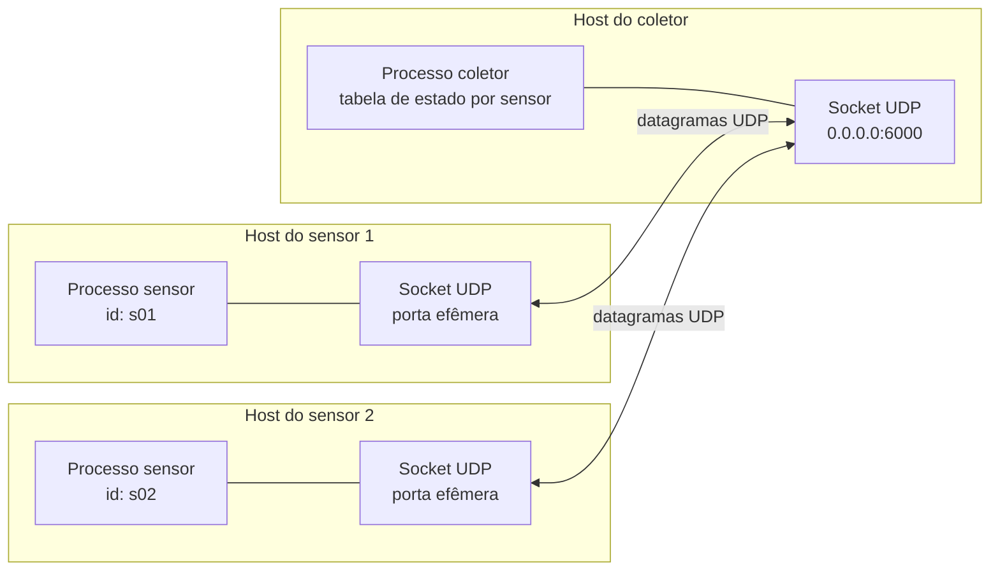
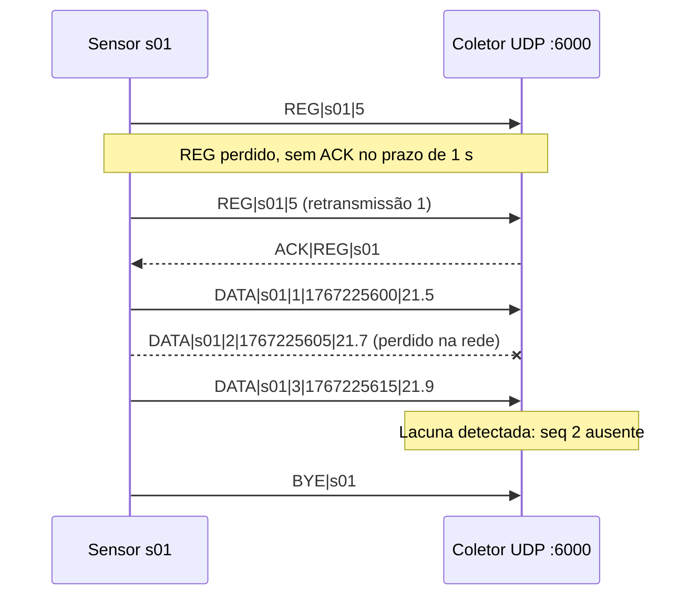
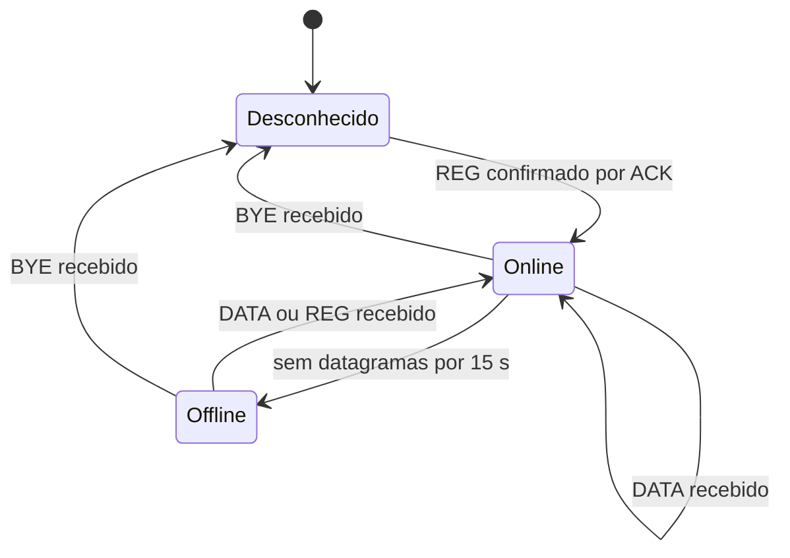

# [Nome do Projeto]: Telemetria de Sensores com Sockets UDP

Trabalho avaliativo da disciplina **Fundamentos de Redes de Computadores**, baseado no Capítulo 2 (Camada de Aplicação) de *Redes de Computadores e a Internet: Uma Abordagem Top-Down*, de Kurose e Ross.

## 1. Descrição da aplicação

Sistema de coleta de telemetria. Sensores (por exemplo, temperatura e umidade) enviam leituras periodicamente a um coletor central, que registra os valores, detecta perdas e identifica sensores que deixaram de responder.

O problema resolvido é a coleta contínua de dados de muitos dispositivos pequenos, em que a leitura mais recente é mais útil que uma leitura antiga entregue com atraso. Isso torna a aplicação um bom caso para UDP.

Requisitos atendidos:

- Um coletor (servidor) e múltiplos sensores (clientes) simultâneos.
- Comunicação por sockets UDP (`SOCK_DGRAM`).
- Protocolo de aplicação próprio, em texto, chamado **TelemP/1.0**.
- Mecanismos próprios de confiabilidade apenas onde são necessários (registro e detecção de perdas).
- Tratamento de erros de rede, de protocolo e de entrada.

## 2. Integrantes

| Nome | Matrícula | Responsabilidade |
| --- | --- | --- |
| Renan Albuquerque Santos | 2025012480 | Servidor |
| Murilo | [matrícula] | Cliente |

## 3. Arquitetura

- **Coletor** (`src/collector.py`): único processo com um socket UDP ligado a uma porta fixa. Recebe datagramas de qualquer sensor, mantém uma tabela de estado por sensor (último número de sequência, último instante visto, situação) e responde apenas aos comandos que exigem confirmação. Não mantém conexão com ninguém.
- **Sensor** (`src/sensor.py`): gera leituras simuladas, envia `REG` e depois um `DATA` a cada intervalo. Cada sensor tem um socket UDP próprio. Retransmite o `REG` até receber `ACK`.
- **Protocolo** (`src/protocol.py`): codificação, decodificação e validação das mensagens TelemP/1.0.



Troca de mensagens com registro, leitura, perda e retransmissão:



Situação de cada sensor no coletor:



## 4. Protocolo de transporte: UDP

**Escolha: UDP** (`socket.SOCK_DGRAM`).

### Justificativa

1. **Dado tolerante à perda.** Uma leitura de temperatura substitui a próxima em poucos segundos. Retransmitir uma leitura antiga só ocupa a rede e atrasa a leitura atual. O livro (seção 2.1.3) afirma que aplicações tolerantes à perda não precisam de transferência confiável, e a Figura 2.4 classifica jogos interativos e telefonia como tolerantes à perda e sensíveis ao tempo, perfil semelhante ao de telemetria.
2. **Sem handshake.** Cada leitura cabe em um datagrama de poucas dezenas de bytes, enviado sem apresentação prévia. Não há atraso de conexão nem tráfego de controle por sensor.
3. **Sem estado de conexão no coletor.** Com centenas de sensores, o coletor não precisa de um socket e de buffers por dispositivo, como ocorreria com TCP (seção 2.1.4: UDP é um serviço não orientado à conexão e minimalista).
4. **Overhead menor.** O cabeçalho UDP tem 8 bytes, contra 20 bytes do TCP, além de não haver segmentos de confirmação para cada dado.
5. **Sem bloqueio de cabeça de fila.** Uma leitura atrasada não segura as seguintes, o que ocorreria em um fluxo TCP (ver o problema HOL discutido na seção 2.2.6).

Limitação assumida: o UDP não tem controle de congestionamento (seção 2.1.4). Por isso a aplicação limita a taxa, com intervalo mínimo de 1 s entre leituras e tamanho máximo de datagrama de 512 bytes.

### E se fosse usado TCP?

Funcionaria, mas com custos que não compensam para esse cenário:

- Cada sensor exigiria um handshake de três vias antes de enviar a primeira leitura, o que aumenta o atraso e o tráfego de controle.
- O coletor manteria uma conexão aberta e buffers por sensor. Com muitos sensores, isso consome memória e recursos do servidor, como discutido na seção 2.2.2 para conexões persistentes.
- Uma leitura perdida atrasaria todas as leituras seguintes até a retransmissão, o que entrega dados antigos com atraso e bloqueia os novos.
- A detecção de sensor offline dependeria de keepalive do TCP, em vez de um simples prazo sem datagramas.
- Em compensação, o TCP entregaria tudo sem perdas e na ordem correta, o que não é necessário aqui.

## 5. Endereço IP e porta

| Item | Valor padrão |
| --- | --- |
| Endereço IP do coletor | `127.0.0.1` em testes locais; IP da máquina do coletor na rede |
| Porta UDP do coletor | `6000` (configurável por argumento) |
| Porta dos sensores | Efêmera, atribuída pelo sistema operacional |

O coletor escuta em `0.0.0.0` por padrão. A porta 6000 está fora das portas bem conhecidas (0–1023), conforme a seção 2.1.2 do livro.

## 6. Protocolo da aplicação: TelemP/1.0

- **Codificação:** ASCII/UTF-8.
- **Unidade de transmissão:** um datagrama UDP contém exatamente uma mensagem. Não é preciso delimitador de fim de mensagem, diferentemente do fluxo TCP. O UDP preserva fronteiras de mensagem.
- **Campos:** separados por `|`.
- **Tamanho máximo:** 512 bytes por datagrama. Datagramas maiores são descartados pelo coletor com `ERR|TOO_LONG`, quando possível.
- **Identificador do sensor:** de 1 a 16 caracteres alfanuméricos, único na rede.
- **Número de sequência:** inteiro crescente por sensor, iniciando em 1 a cada `REG`. Usado para detectar perdas, duplicatas e reordenação.
- **Timestamp:** segundos desde a época Unix, no relógio do sensor.

## 7. Mensagens

**Sensor → Coletor**

| Mensagem | Formato | Confirmação | Descrição |
| --- | --- | --- | --- |
| REG | `REG\|id\|intervalo` | Sim (ACK) | Registra o sensor e informa o intervalo entre leituras, em segundos. Retransmitida até 3 vezes, com prazo de 1 s. |
| DATA | `DATA\|id\|seq\|timestamp\|valor` | Não | Envia uma leitura. Não é retransmitida. |
| BYE | `BYE\|id` | Não | Anuncia saída do sensor. Pode se perder; o coletor então detecta o sensor como offline. |

**Coletor → Sensor**

| Mensagem | Formato | Descrição |
| --- | --- | --- |
| ACK | `ACK\|REG\|id` | Confirma o registro. Só é enviado em resposta a `REG` válido. |
| ERR | `ERR\|código\|descrição` | Informa erro de formato ou de estado (ver seção 8). |

Os valores de `DATA` são sempre numéricos, com faixa aceita de -50 a 150. Valores fora da faixa geram `ERR|VALUE_OUT_OF_RANGE`.

## 8. Tratamento de erros

| Situação | Quem trata | Tratamento |
| --- | --- | --- |
| `REG` ou `ACK` perdido | Sensor | Retransmite `REG` após 1 s, até 3 vezes. Se não houver `ACK`, registra erro e tenta novamente no próximo ciclo. |
| `DATA` perdido | Coletor | Detecta lacuna na sequência e incrementa o contador de perdas do sensor. Não há retransmissão, pois o dado já estaria obsoleto. |
| `DATA` duplicado | Coletor | Descarta quando `seq` já foi processado. |
| `DATA` fora de ordem | Coletor | Descarta quando `seq` é menor que o último aceito, registrando reordenação. |
| Sensor silencioso | Coletor | Após 15 s sem datagramas, marca o sensor como `Offline`. Volta a `Online` com o próximo datagrama. |
| Porta do coletor fechada (ICMP port unreachable) | Sensor | No Linux, o próximo `recvfrom` levanta `ConnectionRefusedError`. Tratado como "coletor indisponível": loga e tenta no próximo ciclo. |
| Mensagem malformada (campos ausentes, tipos inválidos) | Coletor | `ERR\|BAD_REQUEST`. Não altera o estado do sensor. |
| Datagrama acima do limite de 512 bytes | Coletor | Lido com buffer de tamanho limitado; ao detectar truncamento, responde `ERR\|TOO_LONG` e descarta. |
| `REG` com identificador já ativo de outro endereço | Coletor | `ERR\|NAME_IN_USE`. |
| Valor fora da faixa | Coletor | `ERR\|VALUE_OUT_OF_RANGE`. O datagrama é descartado. |
| `DATA` de sensor não registrado | Coletor | `ERR\|NOT_REGISTERED`, para o sensor enviar `REG` novamente. |
| Erro ao enviar (`OSError`, rede inacessível) | Sensor | Captura, registra e tenta no próximo ciclo. |
| Ctrl+C no sensor | Sensor | Tenta enviar `BYE` e encerra. |
| Exceção ao processar um datagrama | Coletor | `try/except` por datagrama; o laço principal continua. |

Observação de segurança: respostas `ERR` são enviadas ao endereço de origem do datagrama. Como o UDP aceita endereços forjados, o coletor deve limitar as respostas de erro e nunca ampliar o tamanho da resposta em relação à requisição.

## 9. Estrutura do repositório

```
trabalho-redes/
├── README.md
├── docs/
│   └── diagrama.png
├── captura/
│   └── telemetry.pcapng
└── src/
    ├── protocol.py
    ├── collector.py
    └── sensor.py
```

## 10. Instruções de execução

**Requisitos:** Python 3.10 ou superior. Não há dependências externas (apenas biblioteca padrão: `socket`, `time`, `random`, `argparse`).

**1. Iniciar o coletor** (em um terminal):

```bash
python3 src/coletor.py --host 0.0.0.0 --port 6000
```

**2. Iniciar um ou mais sensores** (em outros terminais):

```bash
python3 src/sensor.py --host 127.0.0.1 --port 6000 --id s01 --intervalo 5
python3 src/sensor.py --host 127.0.0.1 --port 6000 --id s02 --intervalo 3
```

Para testar em rede local, substitua `127.0.0.1` pelo IP da máquina do coletor.

**Teste de perda simulada:** o sensor aceita `--perda 0.2`, que descarta aleatoriamente 20% dos `DATA` antes do envio. Use para verificar a detecção de lacunas no coletor.

**Saída do coletor:** tabela com id, situação, último valor, número de sequência e contadores de perdas, duplicatas e reordenações.

## 11. Captura de tráfego (Wireshark)

Arquivo: `captura/telemetria.pcapng`. Filtro de exibição: `udp.port == 6000`.

Evidências a apresentar:

1. **Ausência de handshake:** o primeiro datagrama já é `REG`, sem SYN, SYN-ACK ou ACK.
2. **Payload legível:** `REG|s01|5`, `DATA|s01|3|...` e `ACK|REG|s01` aparecem em texto claro (use *Follow UDP Stream*).
3. **Cabeçalho UDP de 8 bytes:** comparar com o cabeçalho TCP de 20 bytes da alternativa de chat.
4. **Retransmissão do REG:** dois datagramas `REG` com intervalo de cerca de 1 s quando o `ACK` é descartado com o filtro de perda do Wireshark ou da simulação.
5. **Lacunas de sequência:** datagramas `DATA` com números de sequência faltando, correspondendo aos registros do coletor.
6. **Ausência de controle de congestionamento:** os datagramas saem no ritmo definido pela aplicação, sem reduções de taxa.

## 12. Mapeamento das questões do projeto

| Questão do projeto | Onde responder |
| --- | --- |
| 1. Qual problema a aplicação resolve? | Seção 1 |
| 2. Quem são os processos envolvidos? | Seção 3 |
| 3. Como ocorre a comunicação? | Seções 3 e 6 |
| 4. Qual protocolo de transporte? | Seção 4 |
| 5. Por que esse protocolo é adequado? | Seção 4, "Justificativa" |
| 6. Qual é o protocolo da aplicação? | Seção 6 |
| 7. Quais mensagens podem ser trocadas? | Seção 7 |
| 8. O que aconteceria com o outro protocolo? | Seção 4, "E se fosse usado TCP?" |
| 9. Quais situações de erro podem ocorrer? | Seção 8 |
| 10. Como essas situações são tratadas? | Seção 8 |
