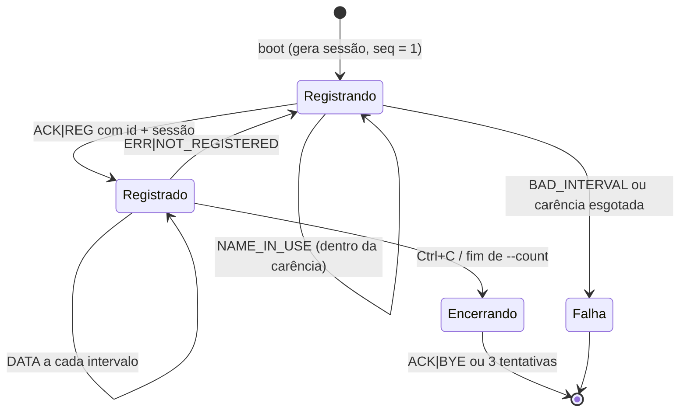

# TelemProto/1.0 — Especificação do protocolo de aplicação

**Status:** rascunho para revisão · **Versão do documento:** 0.1 · **Data:** 2026-10-26

Este documento é a especificação normativa do protocolo. O comportamento interno do
coletor está em [REQUISITOS-SERVIDOR.md](REQUISITOS-SERVIDOR.md); o README é o
documento de entrega e resume o protocolo para o leitor externo.

---

## 1. Escopo

Define o formato, a semântica e as regras de validação das mensagens trocadas entre
**sensor** (cliente) e **coletor** (servidor). Define também a máquina de estados do
sensor e a reação dele a cada erro. Não define a arquitetura do coletor.

## 2. Premissas de transporte

| Item | Regra |
| --- | --- |
| Transporte | UDP sobre IPv4, unicast |
| Unidade | exatamente uma mensagem por datagrama (UDP preserva fronteiras) |
| Tamanho | payload ≤ **512 bytes**; acima disso o coletor responde `ERR\|TOO_LONG` e descarta |
| Codificação | ASCII imprimível (`0x20`–`0x7E`); `CR`, `LF` e `NUL` são inválidos |
| Separador | `\|`; nenhum campo vazio; nenhum `\|` dentro de campo |
| Espaços | proibidos no início/fim de campo e no início/fim do datagrama |
| Início de mensagem | o **coletor nunca inicia** uma mensagem; só responde ao endereço de origem do datagrama |
| Ordenação | o UDP pode reordenar; a aplicação não depende de ordem de chegada |

Consequência prática: não existe delimitador de fim de mensagem, não existe
`Content-Length` e não existe handshake de transporte.

## 3. Gramática (ABNF, RFC 5234)

```abnf
message   = reg / data / bye / ack / err

reg       = "REG"  "|" version "|" sensor-id "|" interval  "|" session
data      = "DATA" "|" version "|" sensor-id "|" session   "|" seq "|" timestamp "|" value
bye       = "BYE"  "|" version "|" sensor-id "|" session
ack       = "ACK"  "|" version "|" acked    "|" sensor-id "|" session
err       = "ERR"  "|" version "|" err-code "|" err-desc

version   = "1"                         ; única versão aceita hoje
acked     = "REG" / "BYE"
sensor-id = 1*16( ALPHA / DIGIT )
session   = 8( DIGIT / %x61-66 )        ; 8 hex minúsculos
interval  = %x31-39 0*3DIGIT            ; 1..9999 (faixa semântica 1..3600)
seq       = %x31-39 0*9DIGIT            ; 1..9999999999
timestamp = DIGIT 0*9DIGIT              ; 0..9999999999
value     = [ "-" ] uint [ "." 1*3DIGIT ]
uint      = "0" / ( %x31-39 0*2DIGIT )

err-code  = "BAD_REQUEST" / "TOO_LONG" / "NOT_REGISTERED" / "NAME_IN_USE"
          / "VALUE_OUT_OF_RANGE" / "BAD_INTERVAL" / "SERVER_ERROR"
err-desc  = 1*40( %x20-7B / %x7D-7E )   ; ASCII imprimível, exceto "|"
```

O maior datagrama possível nesta gramática tem 61 bytes (`DATA` com todos os campos
no limite), muito abaixo do teto de 512.

## 4. Campos

| Campo | Tipo | Regra |
| --- | --- | --- |
| `type` | literal | `REG`, `DATA`, `BYE`, `ACK`, `ERR` — maiúsculas exatas |
| `version` | literal | `1`; outra versão → `ERR\|BAD_REQUEST` |
| `sensor-id` | texto | 1..16 alfanuméricos, **sensível a maiúsculas** (`s01` ≠ `S01`), único na rede |
| `session` | texto | 8 dígitos hexadecimais minúsculos, gerados no boot do processo sensor |
| `interval` | inteiro | segundos entre leituras, 1..3600 |
| `seq` | inteiro | 1..9999999999; começa em 1 **por sessão** e cresce de 1 em 1 por `DATA` enviado |
| `timestamp` | inteiro | segundos desde a época Unix, relógio do sensor |
| `value` | decimal | até 3 casas, sem expoente e sem vírgula; faixa válida −50,000 a 150,000 |
| `err-code` | literal | ver §8 |
| `err-desc` | texto | 1..40 caracteres ASCII, sem `\|`, sem dados ecoados da requisição |

## 5. Mensagens

### 5.1 `REG` (sensor → coletor)

```
REG|1|s01|5|a1b2c3d4
```

Registra a sessão do sensor no coletor e declara o intervalo de envio.

- **Confirmada** por `ACK|1|REG|s01|a1b2c3d4`.
- **Idempotente por `(sensor-id, session)`**: um reenvio do mesmo `REG` apenas gera
  novo `ACK`; contadores, `seq` e valor anterior são preservados.
- `(id, session)` é a identidade da sessão. `session` é gerada no boot
  (`secrets.token_hex(4)`), então **reiniciar o processo muda a sessão**, mas
  **retransmitir o `REG` não muda**.
- Um `REG` com sessão diferente para um `id` que já tem sessão **ativa** é recusado
  com `ERR|NAME_IN_USE`; o estado existente não é alterado.
- Se a sessão anterior já estiver **silenciosa** (sem datagramas além do timeout), o
  `REG` de sessão nova é aceito e a linha antiga é substituída; os contadores finais da
  sessão encerrada vão para o log.
- `REG` também renova a vivacidade do sensor (equivale a um batimento).

### 5.2 `DATA` (sensor → coletor)

```
DATA|1|s01|a1b2c3d4|3|1767225615|21.9
```

Envia uma leitura. **Não é confirmado e não é retransmitido.**

- O primeiro `DATA` de uma sessão **define a linha de base** da sequência: não conta
  perda, qualquer que seja o `seq`.
- `seq` igual ao último aceito → duplicata (descartada, contada).
- `seq` menor que o último aceito e fora da janela recente → atrasado/reordenado
  (descartado, contado).
- `seq` maior que o último aceito → aceito; a diferença menos 1 conta como perda.
- `id` sem sessão registrada ou `session` diferente da registrada → `ERR|NOT_REGISTERED`.

### 5.3 `BYE` (sensor → coletor)

```
BYE|1|s01|a1b2c3d4
```

Anuncia a saída e libera o `id` **imediatamente**. Confirmado por
`ACK|1|BYE|s01|a1b2c3d4`; o sensor reenvia até 2 vezes (500 ms) e encerra de qualquer
forma. Um `BYE` de `id`/`session` desconhecidos é ignorado em silêncio (o emissor está
saindo; não há nada a corrigir) e registrado em log.

### 5.4 `ACK` (coletor → sensor)

```
ACK|1|REG|s01|a1b2c3d4
```

Confirma `REG` ou `BYE`. O campo `acked` diz o que foi confirmado; `sensor-id` e
`session` permitem ao sensor descartar `ACK` atrasado de uma sessão anterior. Nunca é
enviado para `DATA`.

### 5.5 `ERR` (coletor → sensor)

```
ERR|1|NOT_REGISTERED|sensor nao registrado
```

Informa erro de formato ou de estado. É **advisory**: não tem `id` de correlação, não é
confirmado e **nunca** dispara retransmissão. O sensor decide o que fazer pelo código
(§7.3) e registra a descrição em log.

## 6. Regras de correlação e idempotência

| Situação | Regra |
| --- | --- |
| `ACK` recebido | válido apenas se `type`, `id` e `session` casarem com a operação pendente; caso contrário, ignorar |
| `ERR` recebido | sem correlação; tratar só pelo `code` |
| `REG` repetido | novo `ACK`, nenhum efeito colateral |
| `BYE` repetido | novo `ACK`, nenhum efeito colateral |
| `DATA` repetido | descartar, incrementar `dup`, não alterar valor nem `last_seq` |
| `ERR` perdido | não há retransmissão; o sensor segue o ciclo normal |

## 7. Máquina de estados do sensor



### 7.1 Registro

- 1 envio + 3 retransmissões, 1 s de espera cada → janela máxima de 4 s.
- Enquanto não houver `ACK`, **nenhum `DATA` é enviado**.
- Se a janela expirar: log de aviso, descarte da leitura atual e nova tentativa no
  próximo tick (não em laço apertado). O `seq` não é reiniciado.
- `--loss` não se aplica a `REG` nem a `BYE` (a perda dessas mensagens é simulada no
  coletor com `--drop-ack`).

### 7.2 Envio de leituras

- Primeiro `DATA` imediatamente após o `ACK`; os seguintes a cada `interval`.
- Agendamento por *deadline* monotônica (`inicio + n * interval`), não por
  `sleep(interval)` acumulado.
- Se o processo atrasar mais de um intervalo, o tick perdido é descartado (sem rajada).
- `timestamp` = `int(time.time())` no momento da leitura.
- `value` = passeio aleatório em torno de uma base configurável, truncado em 3 casas.

### 7.3 Reação a `ERR`

| Código | Reação do sensor |
| --- | --- |
| `NOT_REGISTERED` | volta a `Registrando` imediatamente, mantém `seq` e sessão; descarta a leitura atual |
| `NAME_IN_USE` | log de aviso e nova tentativa a cada `interval`; se o `id` continuar em uso ao fim da carência, saída com código 5 |
| `BAD_INTERVAL` | falha permanente (configuração inválida): saída com código 2 |
| `VALUE_OUT_OF_RANGE` | bug do sensor: log e segue; a leitura é descartada pelo coletor |
| `BAD_REQUEST`, `TOO_LONG`, `SERVER_ERROR` | log e segue (indica bug ou versão incompatível) |

A carência é `max(15 s, 3 × interval) + 2 s`, contada a partir do primeiro
`NAME_IN_USE`. Ela existe porque o coletor só libera o `id` após o tempo de
inatividade (`max(15 s, 3 × interval)`); a margem de 2 s cobre o atraso entre a
liberação e a próxima tentativa. Se as respostas pararem no meio da carência, o
sensor também encerra com código 5 ao fim dela — não fica em laço indefinido.

## 8. Códigos de erro

| Código | Quando o coletor gera | Efeito no estado do coletor |
| --- | --- | --- |
| `BAD_REQUEST` | tamanho estrutural ok, mas tipo desconhecido, versão ≠ 1, contagem de campos errada, campo vazio, caractere inválido, `id`/`session`/`seq`/`timestamp`/`value` fora da gramática | nenhum |
| `TOO_LONG` | datagrama > 512 bytes | nenhum |
| `NOT_REGISTERED` | `DATA` de `id`/`session` sem registro válido | nenhum |
| `NAME_IN_USE` | `REG` com sessão nova para `id` com sessão ativa | nenhum |
| `VALUE_OUT_OF_RANGE` | `value` numérico fora de [−50, 150] | nenhum |
| `BAD_INTERVAL` | `interval` fora de 1..3600 | nenhum |
| `SERVER_ERROR` | falha inesperada ao processar (após `try/except`) | nenhum |

Ordem de validação (determinística, para o `ERR` ser previsível):
**tamanho → codificação → estrutura/versão → sintaxe dos campos → registro/sessão →
faixa de valor**.

## 9. Constantes

| Constante | Valor |
| --- | --- |
| `MAX_DATAGRAM` | 512 bytes |
| `MAX_ID_LEN` | 16 |
| `SESSION_LEN` | 8 hex |
| `INTERVAL_MIN` / `INTERVAL_MAX` | 1 / 3600 s |
| `VALUE_MIN` / `VALUE_MAX` | −50.0 / 150.0 |
| `REG_TIMEOUT` | 1.0 s |
| `REG_ATTEMPTS` | 4 (1 envio + 3 retransmissões) |
| `NAME_IN_USE_GRACE_MIN` | 15 s (piso da carência) |
| `NAME_IN_USE_GRACE_FACTOR` | 3 × `interval` |
| `NAME_IN_USE_GRACE_MARGIN` | 2 s |
| `BYE_TIMEOUT` | 0.5 s |
| `BYE_ATTEMPTS` | 3 |
| `ERR_MAX_BYTES` | 64 |
| `VERSION` | 1 |

## 10. Segurança e abuso

- **Não há autenticação.** O UDP aceita origem forjada; qualquer host pode enviar
  `DATA` com o `id` de outro sensor. `session` dá idempotência e desempate de sessão,
  **não** autenticidade.
- `ERR` é limitado a 1 por IP de origem por segundo (burst 3) e a 20 por segundo no
  total; acima disso o coletor descarta em silêncio.
- A resposta `ERR` tem no máximo 64 bytes e **nunca ecoa** conteúdo da requisição.
  (A regra original do README, "nunca maior que a requisição", é impossível de cumprir:
  `ERR|1|BAD_REQUEST|...` tem mais de 20 bytes e uma requisição pode ter 1 byte.)
- `NAME_IN_USE` protege contra dois sensores ativos disputando o mesmo `id`; não
  protege contra injeção de `DATA`.
- O coletor nunca cria entrada de tabela a partir de `DATA` ou `BYE` — só `REG` cria.
  Isso impede crescimento de memória por `id` forjado.

## 11. Exemplos

| Datagrama (bytes) | Veredito |
| --- | --- |
| `REG\|1\|s01\|5\|a1b2c3d4` | válido → `ACK\|1\|REG\|s01\|a1b2c3d4` |
| `REG\|1\|s01\|5` | `BAD_REQUEST` (4 campos) |
| `reg\|1\|s01\|5\|a1b2c3d4` | `BAD_REQUEST` (tipo minúsculo) |
| `REG\|2\|s01\|5\|a1b2c3d4` | `BAD_REQUEST` (versão) |
| `REG\|1\|s01\|0\|a1b2c3d4` | `BAD_INTERVAL` |
| `REG\|1\|s01\|5\|A1B2C3D4` | `BAD_REQUEST` (sessão maiúscula) |
| `DATA\|1\|s01\|a1b2c3d4\|0\|1767225615\|21.5` | `BAD_REQUEST` (`seq` ≥ 1) |
| `DATA\|1\|s01\|a1b2c3d4\|3\|1767225615\|21,5` | `BAD_REQUEST` (vírgula) |
| `DATA\|1\|s01\|a1b2c3d4\|3\|1767225615\|200` | `VALUE_OUT_OF_RANGE` |
| `DATA\|1\|s01\|deadbeef\|3\|1767225615\|21.5` | `NOT_REGISTERED` |
| `BYE\|1\|s01\|a1b2c3d4` | válido → `ACK\|1\|BYE\|s01\|a1b2c3d4` |
| 600 bytes | `TOO_LONG` (resposta truncada em 64 B) |
| `\xFF\xFE` | `BAD_REQUEST` (não-ASCII) |

## 12. Versionamento

O campo `version` é obrigatório em toda mensagem. Mudança incompatível de formato ou
de semântica incrementa a versão; o coletor aceita apenas `1` e responde
`BAD_REQUEST` para as demais. Mudanças compatíveis (novo `err-code`, novo campo
opcional no fim) são registradas neste documento sem incrementar a versão.

## 13. Rastreabilidade com o README

| README | Aqui |
| --- | --- |
| §6 protocolo | §2–§4 |
| §7 mensagens | §5 |
| §7 confirmação do `REG` | §5.1, §7.1 |
| §8 erros | §7.3, §8, §10 |
| §8 sensor silencioso | REQUISITOS-SERVIDOR §5 |
| §10 `--loss` | §7.1 (não vale para `REG`/`BYE`) |
